# 🧩 Board Game Engine — Linguagem de Programação Orientada a Objetos (UPE/POLI 2026.2)

Uma **Game Engine** reutilizável, extensível e genérica em Java projetada para interpretar arquivos de configuração JSON e executar múltiplos jogos de tabuleiro tanto no **Terminal (CLI)** quanto em **Interface Gráfica (Java Swing)**, sem necessidade de alterar ou recompilar o código-fonte da aplicação.

---

## 🏛️ Arquitetura e Conceitos de POO Aplicados

- **Abstração e Polimorfismo Puro (`WinCondition`)**: O motor `Game` e a interface gráfica `GameGUI` executam o fluxo da partida, inicializam o tabuleiro, validam jogadas, aplicam capturas/conversões, verificam vitórias e desenham conexões visuais por meio do contrato da interface `WinCondition` (sem nenhum uso de `instanceof`).
- **Padrão Factory Method (`WinConditionFactory`)**: Mapeia e instancia dinamicamente as condições de vitória a partir do parâmetro `tipo` informado no JSON (`ALIGNMENT`, `ELIMINATION`, `REVERSI`, `HEX`, `ATARI_GO`).
- **Desacoplamento de Interface (Core vs. UI)**: A regra de negócio fica centralizada em `Game` e nas implementações de `WinCondition`, permitindo que tanto o modo terminal (`Main`) quanto a interface gráfica (`GameGUI` com `CardLayout`) compartilhem exatamente o mesmo motor.
- **Mapeamento Flexível (`GameConfig` & Gson)**: Utiliza anotações `@SerializedName(alternate = ...)` para aceitar arquivos JSON configurados tanto em português (`linhas`, `colunas`, `jogador`, `descricao`) quanto em inglês (`rows`, `columns`, `players`, `description`).
- **Encapsulamento e Integridade (`Board`)**: Protege o estado interno da matriz e valida limites de coordenadas, casas vazias, contagem de peças e capturas por cerco.
- **Tratamento Resiliente de Exceções**: Utiliza exceções personalizadas (`ConfiguraçãoIvalidaException` e `MovimentaçãoInvalidaException`) para tratar configurações malformadas e jogadas inválidas sem derrubar a aplicação com *stack traces*.

---

## 📐 Diagrama de Classes (Mermaid)

```mermaid
classDiagram
    class Main {
        +main(String[] args)
    }

    class GameGUI {
        -CardLayout cardLayout
        -GameConfig configAtual
        -Game jogoAtual
        +GameGUI()
        -processarArquivoConfig(String caminho)
        -montarPartidaEExibirRegras()
        -construirGradeVisual()
        -processarJogadaVisual(int linha, int coluna)
    }

    class GameLoader {
        +LoadConfig(String caminhodoarquivo) GameConfig
        -validarConfig(GameConfig config)
    }

    class GameConfig {
        +getJogo() String
        +getDescricao() String
        +getTabuleiro() TabuleiroConfig
        +getJogador() PlayerConfig
        +getRegras() RegrasConfig
    }

    class WinCondition {
        <<interface>>
        +verificarVitoria(Board tabuleiro, int ultimaLinha, int ultimaColuna, char simbolo)* boolean
        +inicializarJogo(Board tabuleiro, List~Player~ jogadores)
        +eJogadaValida(Board tabuleiro, int linha, int coluna, char simbolo) boolean
        +executarJogada(Board tabuleiro, int linha, int coluna, char simbolo)
        +verificarVencedorFinal(Board tabuleiro, List~Player~ jogadores) Player
        +getTextoPlacar(List~Player~ jogadores, Board tabuleiro) String
        +obterConexoesVisuais(Board tabuleiro) List~int[]~
        +obterConexoesPreview(Board tabuleiro, int linha, int coluna, char simbolo) List~int[]~
        +obterCaminhoVitoria(Board tabuleiro, int ultimaLinha, int ultimaColuna, char simbolo) List~int[]~
        +mostrarBordasJogadores() boolean
        +getDescricaoRegras() String
    }

    class AlinhamentoWinCondition {
        -int meta
        +verificarVitoria(Board tabuleiro, int ultimaLinha, int ultimaColuna, char simbolo) boolean
        +obterCaminhoVitoria(Board tabuleiro, int ultimaLinha, int ultimaColuna, char simbolo) List~int[]~
    }

    class EliminationWinCondition {
        -int metaCapturas
        -Map~Character, Integer~ pontuacaoCapturas
        +registrarCaptura(char simbolo, int quantidade)
        +executarJogada(Board tabuleiro, int linha, int coluna, char simbolo)
        +getTextoPlacar(List~Player~ jogadores, Board tabuleiro) String
        +verificarVitoria(Board tabuleiro, int ultimaLinha, int ultimaColuna, char simbolo) boolean
    }

    class ReversiWinCondition {
        +inicializarJogo(Board tabuleiro, List~Player~ jogadores)
        +eJogadaValida(Board tabuleiro, int linha, int coluna, char simbolo) boolean
        +executarJogada(Board tabuleiro, int linha, int coluna, char simbolo)
        +verificarVencedorFinal(Board tabuleiro, List~Player~ jogadores) Player
        +getTextoPlacar(List~Player~ jogadores, Board tabuleiro) String
        +verificarVitoria(Board tabuleiro, int ultimaLinha, int ultimaColuna, char simbolo) boolean
    }

    class HexWinCondition {
        -char simboloJogador1
        +inicializarJogo(Board tabuleiro, List~Player~ jogadores)
        +mostrarBordasJogadores() boolean
        +obterConexoesVisuais(Board tabuleiro) List~int[]~
        +obterConexoesPreview(Board tabuleiro, int linha, int coluna, char simbolo) List~int[]~
        +obterCaminhoVitoria(Board tabuleiro, int ultimaLinha, int ultimaColuna, char simbolo) List~int[]~
        +verificarVitoria(Board tabuleiro, int ultimaLinha, int ultimaColuna, char simbolo) boolean
    }

    class AtariGoWinCondition {
        -int metaCapturas
        -Map~Character, Integer~ pontuacaoCapturas
        +eJogadaValida(Board tabuleiro, int linha, int coluna, char simbolo) boolean
        +executarJogada(Board tabuleiro, int linha, int coluna, char simbolo)
        +getTextoPlacar(List~Player~ jogadores, Board tabuleiro) String
        +verificarVitoria(Board tabuleiro, int ultimaLinha, int ultimaColuna, char simbolo) boolean
    }

    class WinConditionFactory {
        +criar(CondicaodeVitoriaConfig config) WinCondition
    }

    class Board {
        -int linha
        -int coluna
        -char[][] tabuleiro
        +exibirTabuleiro()
        +posicaoVazia(int l, int c) boolean
        +marcarPosicao(int l, int c, char simbolo) boolean
        +definirSimbolo(int l, int c, char simbolo)
        +limparPosicao(int l, int c)
        +contarPecas(char simbolo) int
        +marcarECapturar(int l, int c, char simbolo) int
        +posicaoValida(int r, int c) boolean
        +getPosicao(int l, int c) char
        +getLinha() int
        +getColuna() int
        +getSimbolo(int l, int c) char
    }

    class Player {
        -String nome
        -char simbolo
        +getNome() String
        +getSimbolo() char
    }

    class Game {
        -Board tabuleiro
        -List~Player~ jogadores
        -GameConfig config
        -WinCondition winCondition
        -Player jogadoratual
        +prepararPartida()
        +iniciarJogo(Scanner sc)
        +resolverDestinoJogada(int linha, int coluna) int[]
        +validarMovimento(int linha, int coluna, char simbolo)
        +aplicarMovimento(int linha, int coluna, char simbolo)
        +obterResumoRegras() String
    }

    class ConfiguraçãoIvalidaException {
        +ConfiguraçãoIvalidaException(String mensagem)
    }

    class MovimentaçãoInvalidaException {
        +MovimentaçãoInvalidaException(String mensagem)
    }

    Main ..> GameGUI
    Main ..> GameLoader
    Main ..> WinConditionFactory
    Main ..> Game
    GameGUI ..> GameLoader
    GameGUI ..> WinConditionFactory
    GameGUI --> Game
    GameLoader ..> GameConfig
    GameLoader ..> ConfiguraçãoIvalidaException
    WinConditionFactory ..> WinCondition
    WinConditionFactory ..> ConfiguraçãoIvalidaException
    WinCondition <|.. AlinhamentoWinCondition
    WinCondition <|.. EliminationWinCondition
    WinCondition <|.. ReversiWinCondition
    WinCondition <|.. HexWinCondition
    WinCondition <|.. AtariGoWinCondition
    Game --> Board
    Game --> Player
    Game --> GameConfig
    Game --> WinCondition
    Game ..> MovimentaçãoInvalidaException
```

---

## 🎮 Jogos Configurados na Pasta `Games/`

| Arquivo JSON | Jogo | Tabuleiro | Mecânica e Condição de Vitória |
| :--- | :--- | :---: | :--- |
| `jogo_da_velha.json` | Jogo da Velha | 3x3 | Alinhamento de 3 símbolos (`ALIGNMENT`). |
| `Conect_Four.json` | Connect Four | 6x7 | Posicionamento com gravidade real (`GRAVITY`) e alinhamento de 4 peças (`ALIGNMENT`). |
| `gomoku.json` | Gomoku | 15x15 | Alinhamento de 5 peças consecutivas em qualquer direção (`ALIGNMENT`). |
| `jogo_territorio.json` | Domínio e Captura | 5x5 | Captura em sanduíche; vence quem eliminar 3 peças adversárias (`ELIMINATION`). |
| `othello_reversi.json` | Othello / Reversi | 6x6 | Flanqueamento e conversão de peças; vence quem tiver a maioria ao final (`REVERSI`). |
| `hex.json` | Hex | 7x7 | Conexão contínua entre bordas opostas em 6 direções hexagonais (`HEX`). |
| `atari_go.json` | Atari Go | 7x7 | Cerco ortogonal de